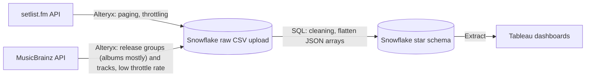

# Encore Row: Touring & Album Cycle Analytics

**An end-to-end data pipeline that simulates an artist management firm looking to track artist performance and tour status**

The timeline was about one week, from API ingestion to the Tableau executive and analyst dashboards.

A little about the technology and data I used...
| | |
|---|---|
| **Tools** | Alteryx · Snowflake (SQL) · Tableau |
| **Sources** | setlist.fm API · MusicBrainz API |
| **Roster** | Bruno Mars · Daniel Caesar · Kendrick Lamar · Mac DeMarco · Sabrina Carpenter |
| **Scale** | 3,448 shows · ~29,000 songs played · 104 release groups · 5,745 album tracks |

## 📊 Dashboards

### Executive Overview: gives 60 second insights to the VP of Touring and Artists
- **KPIs:** top artist by shows, shows played, countries reached, average cycle album share (each vs. the same period last year)
- **Roster status:** a simple table to show each artist's latest album, days since release, shows since release and whether they're on tour
- **What's in each artist's set:** the share of songs from the newest album, with artists below a 30% threshold flagged so executives know to support them more
  - **Why 30%**: While the executive can dynamically change this threshold, it is seen as a good rule of thumb to have about 30-40% of setlists on a new album tour contain songs from that new album

[](https://public.tableau.com/views/EncoreRow-VPofTouringArtistsOverviewDashboard/VPTouringDashboard)

**Click on the dashboard to view in Tableau Public!**


### Analyst Drilldown: follows up on executive questions
- **Cycle album share by month since release:** a heatmap that lines artists up on the same relative timeline and shows the % of songs played in every month since their most recent album's release date that were from that new album, and you can click a cell for the specific songs played that month
- **Days from album release to first tour show:** how long it takes for an artist to start touring after an album release - can ensure tour dates are lined up beforehand
- **Repeat visits by venue:** which venues the roster return to, can click for an artist breakdown

[](https://public.tableau.com/views/EncoreRow-TouringArtistAnalystDashboard/TouringArtistAnalystDashboard)

**Click on the dashboard to view and interact in Tableau Public!**


## 🏗️ Architecture



| Step | Tool | Why |
|---|---|---|
| API calls, paging, rate limits, retries | **Alteryx** | Download, Generate Rows and Throttle handle paging and request limits, and the API key is read from a local file and never stored in the workflow |
| Flatten tracklists to one row per track | **Alteryx** | Nested tracklist JSON exceeded CSV cell limits, so it needed to be flattened before export |
| Load | **Snowflake** | Raw CSVs loaded as-is into `DS_*_RAW` tables |
| Flatten setlists, clean, then model | **SQL (Snowflake)** | `LATERAL FLATTEN` unnests the sets and songs while keeping play order. Then date parsing and other transformations like title normalization are in one script (shown within this repo) |
| Visualize | **Tableau** | Relationship model across two fact tables; extract for Tableau Public |

---

## 🗂️ Data Model


| Table | Type | Grain | Key |
|---|---|---|---|
| `DS_ARTIST` | Dimension | One row per artist | `ARTIST_MBID` |
| `DS_VENUE` | Dimension | One row per venue | `VENUE_ID` |
| `DS_ALBUM` | Dimension | One row per core album (29 curated) | `ALBUM_ID` (MusicBrainz release group) |
| `DS_SONG` | Dimension | One row per song per artist | `SONG_ID` = `ARTIST_MBID` + normalized title |
| `DS_SHOW` | Fact | One row per past show | `SETLIST_ID` |
| `DS_SONG_PERFORMANCE` | Fact | One row per song played per show | `SETLIST_ID` + `POSITION_IN_SHOW` |

**How the sources join:** setlist.fm actually identifies artists by their MusicBrainz ID (M
BID), so artists can easily join across the two APIs. Setlist songs match album tracks on a **normalized song title** (lowercase, bracketed suffixes like *(feat. …)* removed, punctuation stripped). 75–85% of songs played match a core album while the rest are singles, collaborations and covers.

---

## 📐 Key Metrics

| Metric / rule | Definition |
|---|---|
| **Cycle album** | The artist's latest studio album released **on or before** the show date |
| **Cycle album share** | Songs from the cycle album / songs played |
| **Album match rate** | Songs from any core album / songs played |
| **Days to road** | Newest album release date to the first tour show (the show must have a tour name associated with it and at least 15+ songs, which excludes TV and promo sets) |
| **On tour** | Last show happened within the Touring Window parameter (default 90 days) |

---

## 📁 Repository Structure

```
├── alteryx/
│   ├── setlistfm_ingest.yxmd          # setlist.fm pull: paging, throttle, retries
│   └── musicbrainz_ingest.yxmd        # MusicBrainz pull: release groups → tracks
├── sql/
│   └── ddl_dml.sql                    # CREATE OR REPLACE + INSERT for every DS_ table
├── tableau/
│   └── encore_row_touring.twbx        # packaged workbook with extract
├── docs/
│   ├── data_dictionary.md
│   ├── schema_diagram.drawio
│   └── handoff_note.md
├── images/                            # dashboard screenshots and schema diagram
└── README.md
```

---

## ▶️ Reproducing the Pipeline

1. **Get API access:** request a free [setlist.fm API key](https://www.setlist.fm/settings/api) (non-commercial use). MusicBrainz needs no key, only an identifying `User-Agent`
2. **Add your key:** save it in a local file
3. **Run the Alteryx workflows** and output the three raw CSVs.
4. **Load to Snowflake:** create the `DS_*_RAW` tables and load the CSVs
5. **Run `sql/ddl_dml.sql`** in Snowflake
6. **Open the Tableau workbook** and point the data source at your Snowflake tables or use an extract instead

---

## ⚠️ Limitations

- **Fan-logged data:** setlist.fm is crowd-sourced, so recent shows may not be logged yet. Kendrick Lamar's 2025 Grand National Tour is logged under a joint Kendrick Lamar & SZA entry and is missing here, so that increased his days-to-road value and the year-over-year show growth.
- **Not every setlist is a concert:** TV tapings, pop-ups and festival sets are logged too, and a tour-show rule filters them where it matters.
- **Collaborations show up as covers:** setlist.fm labels songs by side projects and features (e.g. Silk Sonic) as covers; these are reclassified as *Collaboration*.
- **City-level coordinates:** venues share their city's latitude and longitude.
- **Hand-maintained album list:** the 29 core albums are curated (excluding bootlegs, demos, live albums and fan compilations) and need updating when an artist releases a new album.

---

## 🔭 What I'd Build Next

- Schedule the pipeline with Alteryx writing straight to Snowflake
- Pull joint-artist entries to close tour data gaps
- Add demand data (ticket prices, listener counts) to test whether new-album shows sell as well as catalogue-heavy ones
- A tour-leg table (show → next show, distance via `HAVERSINE`) for a routing-efficiency map

---

## 🙏 Credits

- Setlist data from [setlist.fm](https://www.setlist.fm), used under its [API terms](https://www.setlist.fm/help/api-terms) for non-commercial use
- Album and track data from [MusicBrainz](https://musicbrainz.org), and no API key needed
- *Encore Row* is a hypothetical client created for this project which isn't associated with any of these artists

**Author:** Dylan Serino
